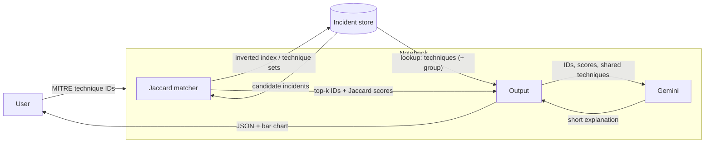
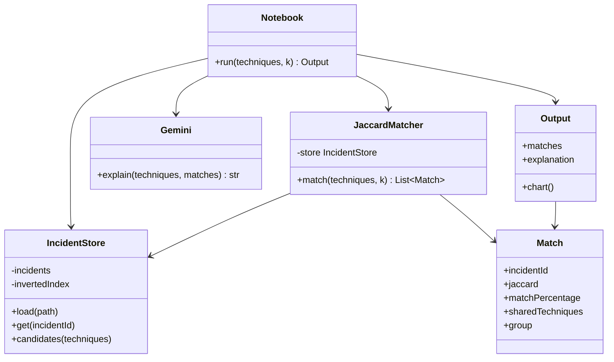
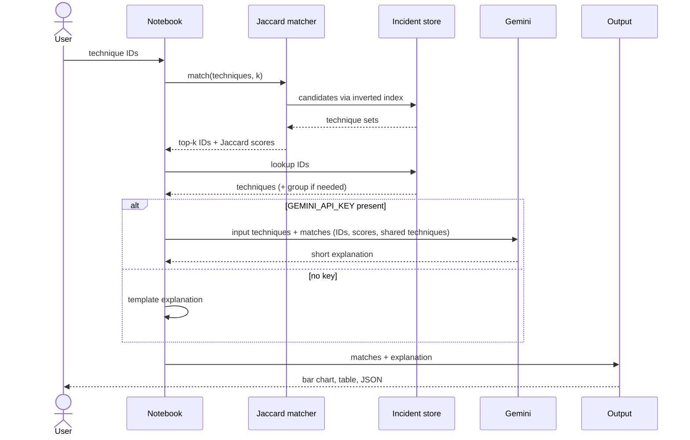

# mitre-attack-threat-group-similarity

Given a list of observed [MITRE ATT&CK](https://attack.mitre.org/) technique IDs, rank historical incidents by **Jaccard similarity** of technique sets and ask Gemini for a short explanation of the top matches.

There are no embeddings (no Gemini embeddings, no TF-IDF). Matching is exact set overlap.

## Data

| File | Description |
| --- | --- |
| `data/incidents_strict.json` | MITRE ATT&CK-derived incident dataset (662 incidents) |
| `data/incidents_example.json` | Small example of the same incident shape |
| `data/examples.json` | `(X, y)` pairs: input technique lists and expected top incident/group |

`incidents_strict.json` matches the `incidents_example.json` shape: `incident_id`, `group`, `techniques`, `description`. The matcher uses only `incident_id`, `techniques`, and `group` (descriptions are not sent to Gemini).

`data/examples.json` `y` is the Jaccard ranking against `incidents_strict.json`, not a Gemini-generated label. Recompute it with:

```bash
python scripts/regenerate_examples.py
```

## Prompts

`prompts/prompt.json` is the Gemini **test prompt**: a short system instruction plus a user template (`{{techniques}}`, `{{matches}}`) asking for a 4–6 sentence explanation of the Jaccard hits.

## MITRE ATT&CK® copyright

`data/incidents_strict.json` is derived from [MITRE ATT&CK®](https://attack.mitre.org/). Per MITRE's terms of use, the copyright designation ships with this data:

> © 2026 The MITRE Corporation. This work is reproduced and distributed with the permission of The MITRE Corporation.

The MITRE Corporation (MITRE) hereby grants you a non-exclusive, royalty-free license to use ATT&CK® for research, development, and commercial purposes. Any copy you make for such purposes is authorized provided that you reproduce MITRE's copyright designation and this license in any such copy.

See [MITRE ATT&CK Terms of Use](https://attack.mitre.org/resources/legal-and-branding/terms-of-use/) and the [attack-stix-data LICENSE](https://github.com/mitre-attack/attack-stix-data/blob/master/LICENSE.txt).

## Architecture

PlantUML and Mermaid sources live in [`docs/`](docs/) (`component`, `class`, `sequence`). The Mermaid versions are embedded below.

### Component diagram



### Class diagram



### Sequence diagram



## Colab prototype

[](https://colab.research.google.com/github/MadAcolyte/mitre-attack-threat-group-similarity/blob/main/notebooks/threat_group_similarity_gemini.ipynb)

[`notebooks/threat_group_similarity_gemini.ipynb`](notebooks/threat_group_similarity_gemini.ipynb) walks through the pipeline above: load the incident store, Jaccard-rank incidents, make **one** Gemini call (`google-generativeai`) for an explanation, and plot match percentages.

**How to run:** open the badge, optionally add a Colab Secret named `GEMINI_API_KEY`, then Runtime → Run all. Without a key the notebook still runs and uses a template explanation.
