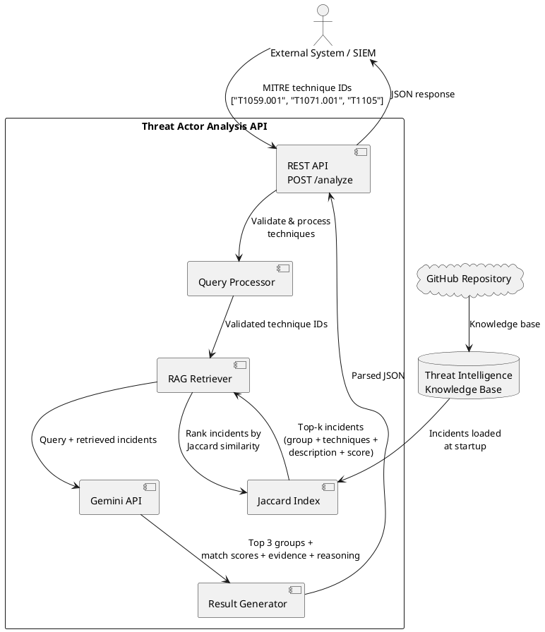
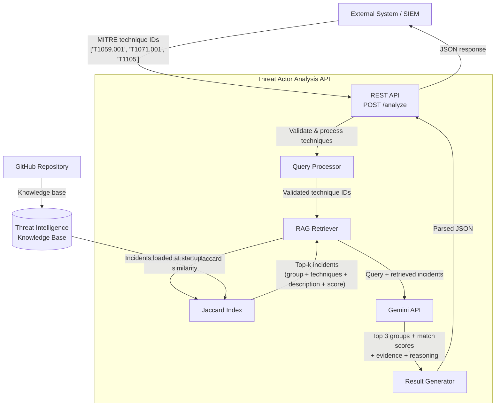
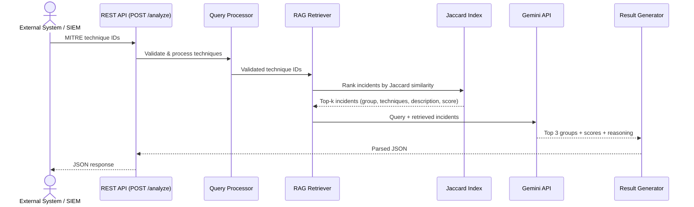

# mitre-attack-threat-group-similarity

## Data

| File | Description |
| --- | --- |
| `data/incidents_strict.json` | MITRE ATT&CK-derived incident dataset (662 incidents) |
| `data/incidents_example.json` | Small example of the same incident shape |
| `data/examples.json` | Example analysis request/response payloads |

`incidents_strict.json` matches the `incidents_example.json` shape: `incident_id`, `group`, `techniques`, `description`.

## MITRE ATT&CK® copyright

`data/incidents_strict.json` is derived from [MITRE ATT&CK®](https://attack.mitre.org/). Per MITRE's terms of use, the copyright designation ships with this data:

> © 2026 The MITRE Corporation. This work is reproduced and distributed with the permission of The MITRE Corporation.

The MITRE Corporation (MITRE) hereby grants you a non-exclusive, royalty-free license to use ATT&CK® for research, development, and commercial purposes. Any copy you make for such purposes is authorized provided that you reproduce MITRE's copyright designation and this license in any such copy.

See [MITRE ATT&CK Terms of Use](https://attack.mitre.org/resources/legal-and-branding/terms-of-use/) and the [attack-stix-data LICENSE](https://github.com/mitre-attack/attack-stix-data/blob/master/LICENSE.txt).

## UMLs

### PlantUML Component diagram




---

### Mermaid UML


### PlantUML Sequence diagram
```
@startuml
actor "External System / SIEM" as Client
participant "REST API\nPOST /analyze" as API
participant "Query Processor" as Query
participant "RAG Retriever" as RAG
participant "Jaccard Index" as Index
participant "Gemini API" as Gemini
participant "Result Generator" as Result

Client -> API : MITRE technique IDs
API -> Query : Validate & process techniques
Query -> RAG : Validated technique IDs
RAG -> Index : Rank incidents by Jaccard similarity
Index --> RAG : Top-k incidents (group, techniques, description, score)
RAG -> Gemini : Query + retrieved incidents
Gemini --> Result : Top 3 groups + scores + reasoning
Result --> API : Parsed JSON
API --> Client : JSON response
@enduml
```


### Mermaid UML



## Colab prototype

[](https://colab.research.google.com/github/MadAcolyte/mitre-attack-threat-group-similarity/blob/main/notebooks/threat_group_similarity_gemini.ipynb)

[`notebooks/threat_group_similarity_gemini.ipynb`](notebooks/threat_group_similarity_gemini.ipynb) is an end-to-end Google Colab prototype of the architecture above. Each notebook section is one UML component: GitHub knowledge base load, Query Processor, Vector Index, RAG Retriever, Gemini API, Result Generator, and `POST /analyze`.

**How to run:** open the badge, add a Colab Secret named `GEMINI_API_KEY` (🔑 Secrets panel), then Runtime → Run all. Without a key the notebook still runs: Gemini embedding/generation cells are skipped and a TF-IDF/Jaccard fallback produces the same JSON shape as `y` in `data/examples.json`.

To refresh `data/examples.json` from **real** Gemini outputs (this will not write placeholder data), set `GEMINI_API_KEY` and run:

```bash
python scripts/regenerate_examples.py
```
